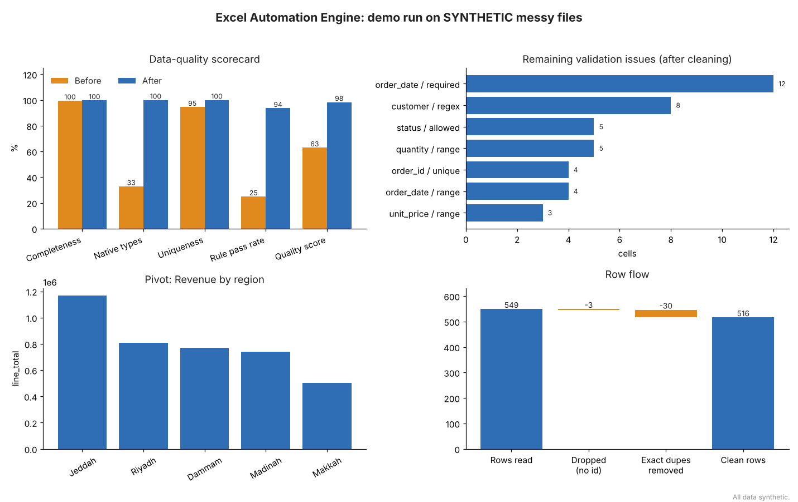
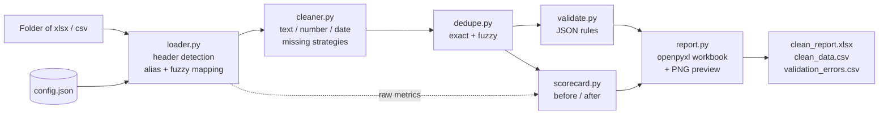

# Excel Automation Engine

A pandas + openpyxl engine that takes a folder of **messy** Excel/CSV files, merges them through a JSON schema (aliases, header auto-detection), cleans them, finds duplicates, validates them against JSON rules, and writes a formatted multi-sheet workbook with a **before/after data-quality scorecard**.

**ملخص بالعربية:** محرك بايثون (pandas وopenpyxl) يدمج ملفات Excel وCSV غير المرتبة من مجلد واحد، مع اكتشاف صف العناوين تلقائيًا وربط العناوين المختلفة (عربي/إنجليزي) بأعمدة موحدة عبر ملف JSON. ينظّف النصوص والتواريخ والأرقام (بما فيها الأرقام العربية الهندية ورموز العملة)، ويكتشف التكرار الدقيق والتقريبي مع ورقة مراجعة، ويتحقق من القواعد مع تقرير أخطاء بإحداثيات الخلايا، ثم يبني تقريرًا منسقًا بعدة أوراق ورسوم Excel أصلية ومؤشر جودة قبل/بعد. **جميع البيانات في المشروع اصطناعية (غير حقيقية).**



*Preview of the demo run (generated by `scripts/demo.py`). All data is synthetic.*

## Features

- **Merge** every `.xlsx`/`.xlsm`/`.csv` in a folder (all sheets). CSV encoding and delimiter are sniffed. The **header row is auto-detected** (banner rows above it are fine) and headers are mapped to canonical columns by exact alias, then by fuzzy match (`difflib`). A mapping table records how each header was matched. Every row keeps `source_file`, `source_sheet`, `source_row`.
- **Clean** with per-column rules: trim and Unicode normalisation, Arabic text normalisation (diacritics, tatweel, alef variants), value maps, multi-format date parsing (ISO, day-first, `12 Mar 2025`, Excel serials, Arabic-Indic digits), numeric coercion (currency symbols, thousands/decimal separators, Arabic-Indic digits, `(negatives)`), and missing-value strategies: `keep`, `drop_row`, `zero`, `mean`, `median`, `mode`, `ffill`, `constant:<value>`. Cells that cannot be parsed are set to missing and listed on an "Unparsed Cells" sheet.
- **Duplicates:** exact (on a normalised key, keeps the first or the most complete row) and fuzzy (token-aware `difflib` similarity inside blocks). Exact duplicates are removed; fuzzy pairs are **only flagged** on a review sheet.
- **Validation** (JSON rules: `required`, `regex`, `range`, `allowed`, `unique`, each `error` or `warning`) producing an error report with the cell address in the original file (`source_cell`) and in the Clean Data sheet (`clean_cell`).
- **Report workbook:** Summary sheet (headline numbers, scorecard, native chart), Clean Data, pivot-style sheets each with a native openpyxl chart, Duplicates Review, Validation Errors, Header Mapping, Files Read, Cleaning Log, Unparsed Cells. Uses named styles, conditional formatting (data bars, severity and verdict colours), frozen headers, autofilter and auto-fit widths. Text that looks like a formula is written as text.
- **CLI** (`argparse`): `merge`, `clean`, `validate`, `report`, `run` (JSON pipeline file). 54 pytest tests.

## Architecture



## Quickstart

```bash
python -m pip install -r requirements.txt   # pandas, numpy, openpyxl, matplotlib, pydantic, pytest
python scripts/demo.py                      # generate messy synthetic files -> pipeline -> workbook + PNG
python -m pytest -q
```

The demo writes `data/messy_inputs/` (5 files), `output/clean_report.xlsx`, `docs/preview.png` and a committed copy of the workbook, [`docs/sample_report.xlsx`](docs/sample_report.xlsx).

## Demo results (real run, seed 42, synthetic data)

`generate_messy_inputs` writes 549 data rows across 5 files (6 sheets/tables): a banner row above the header, CSV with `;` delimiter, Arabic headers with Arabic-Indic digits and Arabic region/status names, typo'd headers, `SAR 1,250.50`-style prices, mixed date formats, and injected problems whose counts are known.

| Injected problem | Injected | Outcome |
|---|---:|---|
| Exact duplicate rows (different formatting across files) | 30 | **30 removed** |
| Fuzzy duplicates (new order id, typo in customer name) | 12 | **12 of 12 flagged** for review (plus 4 other pairs also flagged) |
| Rows with no order id | 3 | 3 dropped (`drop_row`) |
| Same order id, different quantity | 4 | 4 `unique` errors (kept, not removed) |
| Missing customer | 8 | filled with `Unknown`, 8 warnings |
| Invalid dates / missing dates / year typo (2052) | 6 / 6 / 4 | 12 `required` errors, 4 `range` errors |
| Negative quantity / price `0` | 5 / 3 | 5 + 3 `range` errors |
| Unknown status (`Shipped??`) | 5 | 5 `allowed` errors |

Scorecard (from `result.scorecard`, "before" = as delivered, "after" = clean dataset):

| Metric | Before | After |
|---|---:|---:|
| Rows | 549 | 516 |
| Missing cells | 21 | 12 |
| Completeness (%) | 99.5 | 99.7 |
| Cells stored as native numbers/dates (%) | 32.9 | 100.0 |
| Exact duplicate rows | 30 | 0 |
| Rule violations (errors) | 1,432 | 33 |
| Rows with at least one error | 412 | 33 |
| Rule pass rate (%) | 25.0 | 93.6 |
| **Quality score (0-100)** | **63.0** | **98.3** |

How to read these: the quality score is the plain mean of completeness, native-typed %, rule pass rate and uniqueness % (formulas in [`excel_engine/scorecard.py`](excel_engine/scorecard.py)). The "before" rule check is deliberately strict: it validates cells **as delivered**, so a price stored as text `"SAR 1,250.50"` counts as a violation until it is converted. The "before" duplicate count is taken on the type-normalised data, because raw formats differ too much for duplicates to be visible. The 33 remaining errors are the injected problems that cleaning cannot repair; they are reported, not hidden. 9 cells could not be parsed at all and were set to missing.

## CLI usage

```bash
python -m excel_engine merge    data/messy_inputs --config examples/config.json --out merged.csv
python -m excel_engine clean    data/messy_inputs --config examples/config.json --out clean.xlsx
python -m excel_engine validate data/messy_inputs --config examples/config.json --out errors.csv [--fail-on-error]
python -m excel_engine report   data/messy_inputs --config examples/config.json --out report.xlsx [--preview preview.png]
python -m excel_engine run      examples/pipeline.json
```

Real output:

```text
$ python -m excel_engine merge data/messy_inputs --config examples/config.json --out merged.csv
Merged 549 rows from 6 file/sheet table(s) -> merged.csv
Header mapping: 40 exact, 8 fuzzy, 1 unmapped

$ python -m excel_engine validate data/messy_inputs --config examples/config.json --out err.csv
Validation: 33 error(s), 8 warning(s) on 516 clean rows -> err.csv
column      rule      severity
customer    regex     warning      8
order_date  range     error        4
            required  error       12
order_id    unique    error        4
quantity    range     error        5
status      allowed   error        5
unit_price  range     error        3

$ python -m excel_engine run examples/pipeline.json
workbook: output/clean_report.xlsx
clean_csv: output/clean_data.csv
errors_csv: output/validation_errors.csv
preview_png: docs/preview.png
rows read: 549   rows clean: 516   dropped: 3   exact duplicates removed: 30   fuzzy pairs to review: 16
quality score: 63.0 -> 98.3   rule errors: 1432 -> 33
```

A row of the error report (`validation_errors.csv`): `error, range, quantity, -3, "outside range [1.0, 100.0]", sales_arabic_headers.xlsx, المبيعات, 8, E8, ...` points at cell `E8` of the original sheet.

Exit codes: `0` success, `1` for `validate --fail-on-error` when errors remain, `2` for configuration or input errors.

## Configuration

[`examples/config.json`](examples/config.json) shows every option: `columns` (aliases, `type`, `case`, `arabic_letters`, `value_map`, `missing`), `computed` (product of two numeric columns, e.g. `"line_total": "quantity * unit_price"`), `duplicates`, `validation`, `report` (pivots and charts). Unknown keys, alias clashes and references to undefined columns are rejected with a clear error. [`examples/pipeline.json`](examples/pipeline.json) is the `run` file; relative paths resolve against that file's folder.

## Project structure

```text
excel_engine/
  config.py     pydantic models for the JSON config
  textnorm.py   text / number / date parsing helpers (Arabic and English)
  loader.py     file discovery, header detection, schema mapping, merge
  cleaner.py    cleaning rules and missing-value strategies
  dedupe.py     exact + fuzzy duplicate detection, review table
  validate.py   rule engine, error report with cell coordinates
  scorecard.py  before/after metrics
  report.py     openpyxl workbook + matplotlib PNG
  pipeline.py   orchestration and JSON pipeline files
  datagen.py    messy SYNTHETIC input generator (with ground truth)
  cli.py        argparse CLI
examples/       config.json, pipeline.json
scripts/demo.py end-to-end demo
tests/          54 pytest tests
docs/           preview.png, sample_report.xlsx
data/messy_inputs/  the generated synthetic sample files
```

## Testing

```bash
python -m pytest -q    # 54 passed
```

Tests cover number/date/Arabic parsing, config validation, header detection and fuzzy header mapping (including a corrupt file), every cleaning strategy, exact/fuzzy duplicate detection against the injected ground truth, each validation rule type, error cell addresses checked against the original files, scorecard consistency, pivot totals, workbook structure (sheets, charts, freeze panes, conditional formats, named styles, formula-injection safety), generator determinism and the CLI including exit codes.

## Limitations

- **All data is synthetic.** The generator invents names, prices and dates; real files will be messier in ways it does not model. Numbers above describe the synthetic set only and are not accuracy claims for real data.
- Fuzzy duplicates are **suggestions** (4 of the 16 flagged pairs were not injected; they may be coincidental look-alikes). They are never removed automatically.
- Names are not transliterated: the same customer written in Arabic and in English is treated as two customers.
- Ambiguous dates such as `03/04/2025` follow the `dayfirst` setting (default `true`); there is no per-file inference.
- Only `.xlsx`/`.xlsm`/`.csv`. No `.xls`, no merged-cell handling, no formulas (cached values are read), no multi-row headers.
- CSV `source_row` counts records, so a quoted multi-line cell shifts later row numbers.
- Fuzzy matching compares pairs inside a block (O(n^2) per block); without `fuzzy_block_by` it is skipped above `max_unblocked_rows` (default 3000).
- Charts and conditional formatting were generated with openpyxl and checked by reading the file back in tests; they were not visually reviewed in Excel or LibreOffice.
- Missing-value strategies such as `median` invent values by design; use `keep` when that is not acceptable.

## Roadmap

- Per-file date-format inference and `.xls` support.
- A fuzzy-review workflow that applies accepted merges from the review sheet.
- Rules across columns (e.g. ship date after order date).

## Built with AI assistance

This project was built with the help of an AI assistant (Claude). The code, tests and README were drafted with AI help; the numbers above are pasted from real runs of the code in this repository. Review it before relying on it.

## License

MIT, see [LICENSE](LICENSE).
